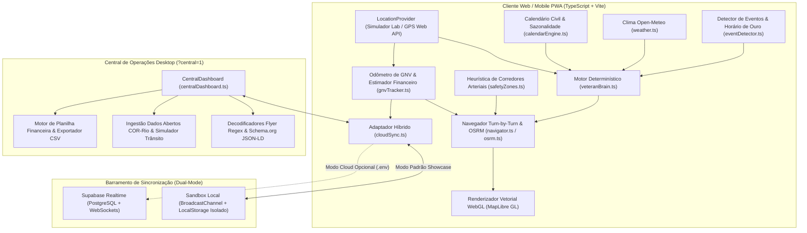

# Arquitetura Técnica · Taxi Copilot (Showcase Edition)

Especificação arquitetural, modelagem matemática e decisões de engenharia do sistema **Taxi Copilot**.

---

## 1. Visão Geral da Arquitetura

O sistema foi projetado sobre uma arquitetura **Local-First com Inteligência Determinística (Zero-LLM-Token Core)**. Todo o processamento crítico de navegação, pontuação espaço-temporal de demanda, avaliação geométrica de rotas e cálculo de autonomia de combustível ocorre diretamente no cliente (navegador/PWA) com latência inferior a $5\text{ ms}$, sem depender de inferência de modelos de linguagem em tempo de execução.

---

## 2. O Núcleo de Decisão Determinístico (*Zero-LLM-Token*)

Sistemas de recomendação baseados em chamadas contínuas a LLMs sofrem de três gargalos incompatíveis com a condução veicular: latência de rede ($1{,}5\text{ s a }5\text{ s}$), custo variável por token e indisponibilidade em zonas de sombra de sinal (como os túneis urbanos do Rio de Janeiro).

No **Taxi Copilot**, a tomada de decisão é 100% algorítmica e local:

- **Tempo de Resposta:** $< 5\text{ ms}$ para reavaliar todos os 36 polos táticos, eventos ativos e alertas viários a cada atualização de coordenada.
- **Resiliência Offline:** Matrizes horárias, calendário de feriados, detector de zonas mortas e odômetro de GNV operam integralmente em memória e `localStorage`, mantendo o cockpit funcional mesmo durante perda temporária de conectividade 4G/5G.
- **Uso Racional de Serviços Externos:** O aplicativo consome apenas serviços geoespaciais abertos ou gratuitos quando disponíveis (tiles vetoriais OpenFreeMap, roteamento público OSRM, geocodificação Photon/Nominatim e meteorologia Open-Meteo), com *throttling* e *fallbacks* seguros.

---

## 3. Modelagem Matemática e Algoritmos Geoespaciais

### 3.1 Distância Geodésica Esférica (`geo.ts`)
Todas as distâncias entre coordenadas $[\lambda, \phi]$ (longitude e latitude em graus convertidos para radianos) são computadas via **Fórmula de Haversine**:

$$d = 2R \arcsin \left( \sqrt{\sin^2\left(\frac{\Delta \phi}{2}\right) + \cos(\phi_1)\cos(\phi_2)\sin^2\left(\frac{\Delta \lambda}{2}\right)} \right)$$

Onde $R = 6\,371\,000\text{ m}$ é o raio médio da Terra.

Para o acompanhamento *Turn-by-Turn* (`snapToLine` e `pointAlong`), o motor projeta ortogonalmente a posição atual do veículo sobre cada segmento da polilinha da rota OSRM, calculando a distância acumulada percorrida e disparando recálculo automático (*rerouting*) caso o afastamento transversal supere $48\text{ metros}$ por dois ciclos consecutivos.

### 3.2 Função de Pontuação Espaço-Temporal (`veteranBrain.ts`)
Para cada polo mapeado $z \in Z$ no instante $t$ e condição meteorológica $w$, a pontuação tática $S(z, t, w)$ é definida por:

$$S(z, t, w) = \frac{\left( B_{z, \text{turno}(t)} \cdot M_{\text{sazonal}}(z, t) + E_z(t) + V_z \right) \cdot M_{\text{clima}}(z, w) - P_{\text{reporte}}(z)}{1 + \alpha \cdot d(\text{motorista}, z)}$$

Onde:
- $B_{z, \text{turno}(t)} \in [1, 10]$: Peso base do polo na faixa horária ativa (7 faixas cobrindo as 24h).
- $M_{\text{sazonal}}(z, t)$: Multiplicador do calendário civil (ex.: $\times 2{,}2$ em terminais rodoviários/aeroportos em vésperas de feriado; redução de polos corporativos em feriados nacionais/municipais).
- $E_z(t)$: Bônus de proximidade temporal a dispersões de grandes eventos na janela do **Horário de Ouro** ($T_{\text{fim}} - 25\text{ min}$).
- $V_z$: Índice estrutural de giro rápido (integração modal com metrô, BRT ou pontos de parada regulamentados).
- $M_{\text{clima}}(z, w)$: Multiplicador meteorológico ($\times 1{,}0$ em tempo seco, $\times 1{,}6$ em chuva moderada e $\times 2{,}5$ em tempestades para áreas cobertas e saídas metroviárias).
- $P_{\text{reporte}}(z)$: Penalidade aplicada se houver bloqueio viário, retenção severa ou zona morta reportada num raio de $350\text{ m}$ do polo.
- $d(\text{motorista}, z)$: Distância em quilômetros até o polo, ponderada pelo fator de decaimento espacial $\alpha$.

### 3.3 Heurística Geométrica de Corredores Arteriais (`safetyZones.ts`)
Para evitar que o roteador OSRM sugira atalhos por vias locais restritas ao contornar congestionamentos, cada polilinha de rota $G = \{p_1, p_2, \dots, p_n\}$ é submetida à verificação geométrica contra o catálogo de perímetros de atenção $C$:

$$\text{Interseção}(G, C) = \exists \, p_i \in G, \, c_j \in C \quad \text{tal que} \quad \text{Haversine}(p_i, \text{centro}(c_j)) \le r(c_j)$$

Quando verdadeiro, a alternativa recebe o selo preventivo `⚠️ Área de Risco` e a interface destaca a alternativa limpa (`🟢 Corredor Seguro`) que permanece nas vias arteriais expressas.

### 3.4 Modelo de Autonomia de GNV e Margem Líquida (`gnvTracker.ts`)
O módulo modela um cilindro padrão de $15\text{ m}^3$ a $16\text{ m}^3$ operando em ciclo urbano com ar-condicionado ($\eta \approx 12{,}5\text{ km/m}^3$, autonomia nominal de $187\text{ km}$ dividida em 4 níveis de $\approx 46{,}8\text{ km}$ mais reserva de $20\text{ km}$):

$$\text{Custo Estimado GNV}(d_{\text{km}}) = \left( \frac{d_{\text{km}}}{\eta} \right) \cdot P_{\text{m}^3}, \qquad \text{Lucro Líquido} = \text{Tarifa Bruta} - \text{Custo Estimado GNV}$$

---

## 4. Camada de Sincronização Dual-Mode (`cloudSync.ts`)

Para atender simultaneamente ao uso em portfólio público e à arquitetura cliente-servidor em tempo real, o serviço `CloudSyncService` implementa o padrão **Adapter** com dois modos de operação:

1. **Modo Sandbox Independente (`isSandboxMode = true` — Padrão no Showcase):**
   - Não realiza nenhuma chamada de rede para bancos de dados externos.
   - Inicializa automaticamente uma base demonstrativa em `localStorage` (sob o prefixo isolado `taxi_showcase:`) contendo 7 corridas sintéticas distribuídas pelos turnos do Rio, abastecimentos de GNV, telemetria simulada (`Táxi Demo #07`) e 4 grandes eventos com *Horário de Ouro* calculado dinamicamente em relação ao horário da sessão.
   - Utiliza a API nativa **`BroadcastChannel('taxi-copilot-showcase-bus')`** para sincronizar eventos em tempo real entre múltiplas abas do navegador (permitindo abrir o Cockpit do Motorista em uma janela e a Central de Operações em outra e observar o disparo de mensagens de voz, alertas de trânsito e corridas ao vivo).
2. **Modo Supabase Realtime (`isSandboxMode = false` — Opcional via `.env`):**
   - Ativado apenas quando `VITE_SUPABASE_URL` e `VITE_SUPABASE_ANON_KEY` são declarados pelo desenvolvedor.
   - Conecta-se via WebSockets (`postgres_changes`) às tabelas `tactical_events`, `city_hazards`, `driver_telemetry`, `dispatcher_messages`, `taxi_trips_log` e `taxi_refuels_log`.
