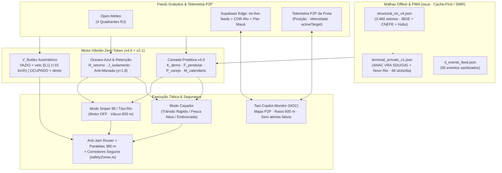

# Do Cérebro Veterano Estático à Física de Fluxo Urbano: A Engenharia Invisível por Trás do Taxi Copilot

> Como uma planilha horária de 377 linhas evoluiu para um motor preditivo multicamadas **Zero-Token** com geometria anti-engarrafamento, dispersão anti-manada, saneamento anti-alucinação e modo Sniper — e por que o que o motorista *não* vê na tela é exatamente o que protege o faturamento e o cilindro de GNV.

---

## O problema de quem olha só para o mapa

Se você abrir o **Taxi Copilot** no celular pela primeira vez, a interface parece propositalmente simples: um mapa do Rio de Janeiro, um botão de **Pesca**, um alternador entre **Caçador** e **Sniper**, e uma instrução direta por voz ou card tático dizendo para onde seguir.

Essa simplicidade na superfície esconde uma mudança profunda de arquitetura.

Quando o primeiro protótipo nasceu em [`web/src/engine/veteranBrain.ts`](../web/src/engine/veteranBrain.ts) (**377 linhas**), a proposta já tinha um diferencial raro: filosofia **Zero-Token** — operar 100% deterministicamente no cliente a custo de **R$ 0,00** em chamadas de IA e com resposta em milissegundos, sem depender de LLM na nuvem para decidir a próxima esquina.

Mas um código que modela apenas *"onde há demanda a esta hora?"* esbarra rápido em armadilhas reais das ruas do Rio de Janeiro:

1. **O paradoxo da recomendação popular:** se um ponto é bom e o sistema manda vários táxis vazios para lá ao mesmo tempo, a probabilidade individual de embarque desaba. É o *Oceano Vermelho*.
2. **O custo oculto do engarrafamento com carro vazio:** com passageiro a bordo, ficar preso num sinal lento ainda remunera tempo no taxímetro; com o carro **vazio**, cada minuto parado queima GNV e destrói a margem por hora.
3. **Chuva local vs. chuva na cidade inteira:** temporal na Barra da Tijuca não deve multiplicar o score de Copacabana ou do Centro.
4. **Dados públicos sujeitos a ruído:** páginas de ingressos quebram HTML, eventos online ("Webinar via Zoom") se infiltram em buscas municipais, e horários médios de aeroporto não batem com ondas reais de desembarque.
5. **Túneis e "Lie-Fi" no 4G:** de nada adianta um algoritmo brilhante se o app trava na tela branca ao sair do Túnel Rebouças porque o navegador ficou pendurado esperando resposta da rede.

A evolução de [`web/src/engine/veteranBrain.ts`](../web/src/engine/veteranBrain.ts) até o conjunto atual em [`Taxi-Copilot-Light`](../Taxi-Copilot-Light) (com [`veteranBrain.ts`](../Taxi-Copilot-Light/src/engine/veteranBrain.ts) em **1.359 linhas** e seus módulos acoplados) + o NOC [`Taxi-Copilot-Monitor`](../Taxi-Copilot-Monitor) foi justamente transformar **sabedoria empírica de ponto** em **física computacional de oferta, demanda e fluidez viária**.

---

## De `v1` para a arquitetura atual: visão panorâmica

### Comparativo direto da evolução

| Dimensão | Cérebro Veterano Original (`web/`) | Arquitetura Atual (`Taxi-Copilot-Light` + `Monitor`) |
|---|---|---|
| **Base horária** | Matriz discreta de 7 turnos (`SHIFTS`) + 7 picos gaussianos fixos | Turnos base + microclima 4-quadrantes + vetores contínuos `v4.0` (`K_demo`, `F_pendular`, `P_varejo`, `M_calendario`) |
| **Granularidade urbana** | 44 zonas curadas manualmente | Zonas curadas + 7 paralelas tangenciais (`tan_*`) + descoberta DATA.RIO/OSM + malha com **3.460 células** censitárias |
| **Clima (`M_clima`)** | `rainLevel` único global (`1.0`, `1.6`, `2.5`) | Grade **4-quadrantes Open-Meteo** (`Centro`, `Zona Sul`, `Barra`, `Zona Norte`) avaliada por coordenada (`rainAt`) |
| **Terminais (`V_transporte`)** | Degraus horários estáticos (`2`, `1`, `0.5`) | Grade **ANAC VRA + Novo Rio** (48 slots/dia $\times$ 7 dias, lag `+25/+40 min`) + painel ao vivo Galeão + cruzeiros Píer Mauá |
| **Competição / Manada** | Inexistente (todos iam para o topo do ranking) | Índice **Oceano Azul** com expoente $\gamma = 1{,}8$, baias fixas SMTR, carros próximos (`1.500 m`) e carros **a caminho** (`800 m`) |
| **Trânsito (`V_fluidez`)** | Penalidade linear branda ($\alpha = 0{,}25$) | **Assimetria radical `VAZIO` vs `OCUPADO`:** carro vazio veta `< 15 km/h` / bloqueios (`0`) e sintetiza paralela de escape a `380 m` |
| **Estratégia de espera** | Sempre rodar ou ir ao ponto tradicional | **3 Verbos Táticos** no Caçador + **Modo Sniper** (parado, motor desligado até `12 min`, vácuo de `600 m` para 99/Táxi.Rio) |
| **Sanidade de eventos** | Lista estática / curadoria manual | Pipeline automático (Sympla, Qualistage, Vivo Rio, Píer Mauá, COR) com **portão anti-clone, geofence municipal e filtro semântico** |
| **Resiliência offline** | *localStorage* básico | **Service Worker** (`sw.js`) com timeout anti-*Lie-Fi* (`2,2 s`), cache *Stale-While-Revalidate* das malhas e até **450 tiles vetoriais** |

---

## 1. Onde o Cérebro Veterano original parava — e o que acontecia na rua

No arquivo [`web/src/engine/veteranBrain.ts`](../web/src/engine/veteranBrain.ts), a equação de decisão era elegante, mas unidimensional:

$$\text{Score}(H, t) = \frac{(B_{\text{hora}} + E_{\text{saída}} + V_{\text{transporte}}) \cdot M_{\text{clima}}}{1 + 0{,}25 \cdot T_{\text{engarrafamento}} + 0{,}15 \cdot D_{\text{distância}}}$$

Na prática de rua, três limites apareciam rapidamente:

1. **Demanda alta não garante corrida alta:** se um hotel na Av. Atlântica tem score 9,0, mas existem uma baia lotada e quatro colegas rodando a 500 metros, o seu tempo até embarcar dispara. A equação `v1` não enxergava os outros táxis.
2. **Desconto tímido de trânsito:** mesmo com alerta de retenção próximo (`traffic = 2.5` ou `5`), o denominador `1 + 0.25 * traffic` apenas reduzia o score em ~38% a ~55%. Em horários de pico chuvoso ($M_{\text{clima}} = 2{,}5$), um polo engarrafado continuava vencendo o ranking e puxando o táxi vazio para dentro de um nó viário.
3. **Calendário sem bolso nem relógio fino:** sábados, vésperas de feriado e início de mês mudam completamente o tipo de passageiro (quem paga corrida de mercado com compras ou corrida corporativa), mas só havia diferenciação básica de dia da semana, ENEM e horário de fechamento de shopping (`21h` vs `22h`).

---

## 2. As heurísticas "invisíveis": por que elas mudam o jogo sem poluir a tela

Boa engenharia para uso veicular tem uma regra dura: **o motorista não pode ler gráficos complexos a 40 km/h**. A maioria das melhorias abaixo nunca aparece como formulário ou botão extra — elas operam silenciosamente no ranqueamento, na escolha da rua e no silêncio seletivo dos alertas.

### 2.1 Camada Preditiva Contínua `v4.0`: o pulso da cidade em 4 vetores

Em [`Taxi-Copilot-Light/src/engine/veteranBrain.ts`](../Taxi-Copilot-Light/src/engine/veteranBrain.ts), o peso base de cada zona passou a ser modulado por quatro vetores contínuos alimentados por uma malha offline compilada por [`scripts/build_v4_structural.py`](../scripts/build_v4_structural.py) (`structural_rio_v4.json`, com **3.460 células** derivadas de **13.782 setores censitários** e **3,27 milhões de endereços CNEFE**, indexadas em $O(1)$ por buckets espaciais):

* **Vetor A — Demografia Real (`K_demo`, `computeDemographicFactor`):** combina renda domiciliar (`idxRenda`) e proporção de moradores 60+ (`idxIdoso`). Entre `08h30` e `16h00`, o peso da população idosa sobe de `0.10` para `0.45`. *Impacto invisível:* em bairros como Copacabana, Tijuca e Flamengo, o algoritmo prioriza naturalmente o entorno de clínicas, laboratórios e mercados onde passageiros idosos optam pelo táxi no meio da manhã, sem precisar de um rótulo "horário do idoso" na tela.
* **Vetor B — Ondas Pendulares (`F_pendular`, `computePendularPulse`):** substitui degraus bruscos entre turnos por curvas gaussianas contínuas (`gaussianPulse`) com pico às **07h45** ($\sigma = 45\text{ min}$) em setores residenciais/hoteleiros e às **18h15** ($\sigma = 45\text{ min}$) em eixos corporativos e conexões Metrô/VLT/SuperVia — automaticamente atenuadas para `0.40` aos sábados e `0.15` em domingos/feriados.
* **Vetor C — Antecipação de Fechamento de Varejo (`P_varejo`, `computeRetailClosingPulse`):** em vez de esperar o relógio bater `22h00` (ou `21h00` aos domingos/feriados), a gaussiana de varejo tem pico centrado **5 minutos antes** (`closingMin - 5`, $\sigma = 22\text{ min}$). *Impacto invisível:* cinco minutos de antecedência é a diferença entre pegar o último lote de funcionários e clientes com sacolas saindo pela porta ou chegar quando os outros carros já limparam a calçada.
* **Vetor D — Liquidez Fiscal e Sazonal (`M_calendario`, [`calendarEngine.ts`](../Taxi-Copilot-Light/src/engine/calendarEngine.ts)):** calcula automaticamente os dias úteis do mês e identifica janelas de pagamento sem intervenção manual:
  * **1º ao 6º dia útil (`SALARIO_MES`):** $\times 1{,}22$ em `SHOPPING`, `MERCADO`, `GASTRONOMIA` e `BOEMIA` (e $\times 1{,}12$ no eixo corporativo diurno).
  * **Dias 20–22 (`ADIANTAMENTO`):** $\times 1{,}16$ nas mesmas categorias de consumo.
  * **Primeiros 5 e últimos 5 dias úteis (`INSS_PICO`, 08h–16h):** eleva o peso de `HOSPITAL`, `MERCADO` e `RESIDENCIAL_NOBRE` ($\ge 1{,}14$).
  * **Feriados e ENEM:** derruba `CORPORATIVO` para `0.08` em feriados (evitando o erro amador de rodar no Centro vazio), dobra `TERMINAL` ($\times 2{,}2$) na tarde/noite de véspera de feriadão e injeta janelas exatas de entrada (`13h00`) e saída (`18h30`) na UERJ e PUC-Rio em domingos de ENEM.

> [!NOTE]
> Mesmo o clima deixou de ser global: [`weather.ts`](../Taxi-Copilot-Light/src/services/weather.ts) consulta os 4 quadrantes do Rio via Open-Meteo (`Centro / SDU`, `Zona Sul`, `Barra / Recreio`, `Zona Norte / GIG`). Cada polo recebe apenas o multiplicador da chuva sobre o **seu** quadrante (`ctx.rainAt(zone.pos)`).

---

### 2.2 Terminais Reais e Portão de Sanidade Anti-Alucinação para Eventos

#### Terminais orientados por passageiro no meio-fio, não por horário de pouso
Um avião pousar no Galeão às 14h00 não significa passageiro na fila de táxi às 14h00. O script [`scripts/build_terminal_schedules.py`](../scripts/build_terminal_schedules.py) processa os microdados oficiais da **ANAC VRA** (`SBRJ` Santos Dumont e `SBGL` Galeão) junto da curva da Rodoviária Novo Rio em `terminal_arrivals_v1.json` (**48 slots de 30 minutos $\times$ 7 dias**), somando uma defasagem física realista antes de pontuar a corrida:
* **+25 minutos** para voos domésticos (desembarque até a pista externa).
* **+40 minutos** para voos internacionais no Galeão (esteira e alfândega).

Por cima dessa grade offline, [`supabase/functions/rio-live-feeds/index.ts`](../supabase/functions/rio-live-feeds/index.ts) e [`openData.ts`](../Taxi-Copilot-Light/src/services/openData.ts) aplicam sobreposições ao vivo do painel do **RIOgaleão** e da programação de cruzeiros do **Píer Mauá** (`t_piermaua` retorna rigorosamente `0` quando não há navio atracado ou programado na janela).

#### O "escudo silencioso" contra shows fantasmas e links quebrados
Na versão automática de eventos ([`scripts/rj_event_harvester.py`](../scripts/rj_event_harvester.py), `rj_events_feed.json` com 50 eventos e [`openData.ts`](../Taxi-Copilot-Light/src/services/openData.ts)), o maior risco de automatizar Sympla, Qualistage, Vivo Rio e COR-Rio não é perder um evento — é mandar o motorista de madrugada para um endereço errado ou um evento inexistente.

Por isso, `isSaneOpportunity` e `sanitizeEventBatch` em [`openData.ts`](../Taxi-Copilot-Light/src/services/openData.ts) filtram cada item antes de qualquer cálculo de score:

1. **Bloqueio de ruído online e genérico:** descarta títulos/locais contendo `webinar`, `zoom`, `online`, `youtube`, `visitação`, `exposição permanente` e endereços vagos (`rio de janeiro`, `evento rj`, `brasil`).
2. **Caixa geográfica estrita do Município do Rio:** exige coordenadas dentro de `lng ∈ [-43.79, -43.09]` e `lat ∈ [-23.08, -22.74]` tanto para o `venue` quanto para a esquina de escape (`escape`).
3. **Integridade temporal e URL:** exige protocolo `https://`, duração plausível entre **20 minutos e 18 horas** e presença na janela ativa de até **21 dias**.
4. **Detector Anti-Clone de Scraping:** se uma mesma casa/plataforma (`QUALISTAGE` ou `VIVORIO`) aparecer com **3 ou mais títulos distintos no exato mesmo timestamp `eventStart`** (sintoma típico de parser capturando uma data fixa do rodapé da página), todo o lote suspeito é descartado automaticamente.
5. **Deduplicação espaço-temporal semântica:** unifica eventos idênticos vindos de fontes diferentes num raio `< 400 m` e `< 2,5 h` que compartilhem palavras-chave relevantes.

---

### 2.3 Física de Retenção e Oceano Azul ($\gamma = 1{,}8$): fugir da manada antes de encontrá-la

Essa é a virada matemática mais importante em [`Taxi-Copilot-Light/src/engine/veteranBrain.ts`](../Taxi-Copilot-Light/src/engine/veteranBrain.ts): o score final deixa de medir "quanta gente quer táxi ali" e passa a medir **excesso de demanda por táxi disponível**, penalizado exponencialmente pela concorrência real e antecipada.

$$\text{Índice}_{\text{Vácuo}} = \text{clip}_{[0{,}12,\; 2{,}2]}\!\left( R_{\text{retorno}} \cdot (1 + 0{,}4 \cdot J_{\text{isolamento}}) \cdot \frac{1{,}35}{(1 + S_{\text{táxis}})^{1{,}8}} \right)$$

Onde cada peça cumpre um papel invisível na coordenação da frota:

* **Saturação Estrutural + Concorrência em Movimento ($S_{\text{táxis}}$):**
  $$S_{\text{táxis}} = S_{\text{crônica}} + 0{,}32 P_{\text{baia}} + 0{,}90 P_{\text{locais}} + 0{,}85 P_{\text{em rota}}$$
  Corredores historicamente saturados (`CHRONIC_TAXI_SATURATION`, como Copacabana `0.85`, Centro `0.78`, Botafogo/Ipanema `0.72`) já largam com peso de oferta alta. Somam-se a isso as baias fixas SMTR próximas (`400 m`), colegas vazios no raio de `1.500 m` (`countNearbyPeers`) e — o detalhe mais sutil — colegas que ainda estão longe, **mas já travaram rota para aquele mesmo destino** (`countInboundPeers`, raio de `800 m` lido via `activeTarget`). Com expoente $\gamma = 1{,}8$, 2 ou 3 carros apontando para o mesmo polo derrubam o atrativo exponencialmente e **dispersam a frota naturalmente sem nenhuma ordem central**.
* **Física de Retenção (`ARTERIAL_BOTTLENECKS` / `computeIsolationFactor`):** quando o Túnel Rebouças, Túnel Santa Bárbara, Túnel do Joá, Linha Vermelha/Av. Brasil ou Linha Amarela travam, menos táxis cheios vindos de fora conseguem "desaguar" e repor oferta nos bairros atrás do bloqueio. Bolsões dependentes daquele eixo (`distância ≥ 900 m` do nó travado) ganham bônus de **Vácuo de Oferta** (`isolationBoost` até `+0.45`).
* **Drenagem Empírica (`computeDrainageRatio` & `buildEmpiricalFromFleetTrips`):** em vez de olhar só quantas corridas começam num lugar, compara saídas vs. desembarques em células de `~440 m` do histórico real da frota (`dest >= 4 && rRetorno < 0.25` marca zona morta automaticamente).

---

### 2.4 Assimetria `VAZIO` vs `OCUPADO` e Rotas Tangenciais (`v2.1`)

Em [`veteranBrain.ts`](../Taxi-Copilot-Light/src/engine/veteranBrain.ts) e [`antiJamRouter.ts`](../Taxi-Copilot-Light/src/nav/antiJamRouter.ts), o aplicativo passou a tratar o carro em dois estados físicos opostos:

| Estado do Táxi | Fluidez (`computeFluencyFactor`) | Estratégia no OSRM (`selectBestRouteForState`) |
|---|---|---|
| **VAZIO (`occupied === false`)** | **Chave binária `{0, 1}`:** qualquer `ROAD_CLOSED` ou `HEAVY_TRAFFIC` a `≤ 650 m`, ou velocidade P2P mediana da frota `< 15 km/h` (`estimateCorridorSpeedKmh`), **zera a zona (`0`)**. | Veto rígido a retenções. Se todas as rotas diretas colidem com engarrafamento, [`fetchAntiJamRoutes`](../Taxi-Copilot-Light/src/nav/antiJamRouter.ts) gera até **2 desvios perpendiculares ("paralelas de fuga") a 380 m** fora das zonas de risco e testa caminhos livres no OSRM. |
| **OCUPADO (`occupied === true`)** | Mantém `1.0` no trânsito lento (passageiro remunera tempo parado); reduz para `0.35` apenas em via totalmente fechada. | Prioriza **segurança + menor tempo/trajeto direto**, evitando desvios longos desnecessários e áreas de risco. |

> [!TIP]
> Além dos desvios dinâmicos no OSRM, foram inseridos **7 eixos paralelos e cruzamentos tangenciais curados** (`tan_copa_tonelero`, `tan_copa_pompeia`, `tan_bota_realgrandeza`, `tan_bota_menabarreto`, `tan_ipanema_redentor`, `tan_centro_riachuelo`, `tan_tijuca_marizebarros`) para guiar o carro vazio a `35–38 km/h` pelas transversais livres em vez de desfilar no comboio lento da Av. N. S. de Copacabana, Barata Ribeiro ou Av. Rio Branco.

---

### 2.5 Os 3 Verbos Táticos + Modo Sniper 99 / Táxi.Rio (`sniperMode.ts`)

Nem todo polo pode ser trabalhado da mesma forma — parar na Praia de Botafogo ou na Av. Rio Branco rende multa de câmera da CET-Rio; desfilar a 45 km/h na porta de um hospital perde o embarque. A heurística `getTacticalDirective` traduz qualquer zona ranqueada em exatamente **três comportamentos claros**:

1. **`TRANSITO_RAPIDO`** (`> 650 m` do alvo): pise fundo a `45 km/h` pela faixa central até o setor.
2. **`PESCA_ATIVA`** (shoppings, mercados, BRS, hospitais): desfile contínuo a `20–38 km/h` na faixa da direita — **não parar**, com alerta específico em locais com câmera/BRS e feedback automático de *"Sem passageiro... seguindo para o próximo polo"* ao cruzar a saída (`getZoneClearanceFeedback`).
3. **`EMBOSCADA`** (teatros, saída de shows, filas oficiais SMTR de terminais): encoste na esquina de escape segura e aguarde 5 minutos desligado.

Já o **Modo Sniper** ([`Taxi-Copilot-Light/src/engine/sniperMode.ts`](../Taxi-Copilot-Light/src/engine/sniperMode.ts)) inverte completamente a lógica do táxi de rua para quem opera **99 / Táxi.Rio**:
* Combina **14 bolsões residenciais internos curados** (`RIO_SNIPER_POCKETS`, como Bairro Peixoto, Rua Paissandu, Visconde de Caravelas, Praça São Salvador, Praça Afonso Pena / R. Alzira Brandão, Alda Garrido) com até **8 bolsões extraídos automaticamente** da malha `structural_rio_v4.json` usando corte estrito (`densRes >= 0.78`, `densEsc <= 0.30`, `hubPeso <= 0.25`, `idxRenda >= 0.68`).
* Exige **Vácuo de 600 m** (`SNIPER_PEER_VACUUM_RADIUS_M = 600`) contando concorrentes parados *ou* já navegando até o setor.
* Guia o motorista até uma esquina arborizada tranquila para **desligar o motor por até `12 min`** (`SNIPER_WAIT_MAX_MIN`), capturando o chamado de moradores dos prédios ao redor com **2–3 minutos de vantagem no ETA** e gasto zero de combustível enquanto espera.

---

### 2.6 Blindagem Silenciosa: Segurança Geográfica, PWA em Túneis e Sinergia com o NOC

Três camadas operam completamente nos bastidores, mas evitam os piores acidentes operacionais:

1. **Corredores Seguros como pré-condição matemática ([`safetyZones.ts`](../Taxi-Copilot-Light/src/engine/safetyZones.ts)):** os 10 perímetros de `RIO_DANGER_ZONES` (Maré, Alemão, Jacarezinho, Chapadão, Vila Aliança, Cidade de Deus, Dendê, Rocinha, Macacos e Juramento) atuam como filtro rígido em todas as camadas. Nem um desvio perpendicular de `380 m` no `antiJamRouter.ts`, nem uma zona `tan_*`, nem um bolsão gerado automaticamente em `sniperMode.ts` pode cair dentro dessas áreas (e isso é travado por teste automatizado em [`veteran.test.ts`](../Taxi-Copilot-Light/src/engine/veteran.test.ts)).
2. **PWA à prova de túnel e "Lie-Fi" ([`public/sw.js`](../Taxi-Copilot-Light/public/sw.js) / [`dist/sw.js`](../Taxi-Copilot-Light/dist/sw.js)):** no 4G de corredor engarrafado, o celular frequentemente fica em "falsa conexão" (*Lie-Fi*). O Service Worker aplica timeout de **2,2 segundos** no app shell (`Network-First`), **Cache-First** nos bundles versionados (`/assets/*`), **Stale-While-Revalidate** nas malhas JSON offline e mantém um cache LRU de até **450 vector tiles OpenFreeMap** para o mapa nunca apagar dentro de túneis.
3. **Sinergia limpa com o NOC ([`Taxi-Copilot-Monitor`](../Taxi-Copilot-Monitor)):**
   * Na torre de controle, [`MonitorMap`](../Taxi-Copilot-Monitor/src/ui/monitorMap.ts) agora desenha em tempo real os **raios de vácuo de 600 m** dos carros em Modo Sniper (`sniper-vacuums`), diferencia `🎯 SNIPER STANDBY (MOTOR OFF)` de `🎯 ROTA SNIPER 99/TÁXI` e evita chamadas OSRM redundantes enquanto o motorista está estacionado em tocaia.
   * **Correção vital de arquitetura no check-up:** no Monitor antigo, `syncOpenTrafficFeeds()` injetava alertas estáticos artificiais de trânsito para demonstração. Com o novo veto binário da `v2.1` no táxi vazio, dados falsos passariam a banir bairros reais da tela do motorista. Esses alertas fictícios foram removidos — hoje o Monitor ingere apenas o feed real do COR-Rio e da Edge Function `rio-live-feeds`, e quando um bloqueio real entra no banco, [`rerouteIfImpactedByHazard`](../Taxi-Copilot-Light/src/main.ts) recalcula na hora a rota anti-engarrafamento do carro vazio.

---

## O impacto real do que "não aparece na tela"

| Heurística Silenciosa | Mecanismo Técnico | Impacto Prático no Dia do Taxista |
|---|---|---|
| **Chave binária + paralela `380 m` no estado `VAZIO`** | `computeFluencyFactor` + `fetchAntiJamRoutes` | Corta quilometragem morta e tempo parado queimando GNV entre corridas sem obrigar desvios quando já há passageiro no carro. |
| **Expoente Anti-Manada ($\gamma = 1{,}8$) + `activeTarget`** | `evaluateSniperPockets` / `scoreZone` | Evita que 5 colegas da mesma rede corram para a mesma esquina ao mesmo tempo; preserva fila curta em cada ponto. |
| **Filtro anti-clone + geofence em eventos** | `isSaneOpportunity` + `sanitizeEventBatch` | Impede perda de 20–40 min deslocando carro vazio para webinars, locais genéricos ou datas clonadas por erro de scraper. |
| **Antecipação gaussiana `-5 min` e lag `+25/+40 min`** | `computeRetailClosingPulse` + `evaluateTerminalArrivals` | Posiciona o táxi quando o passageiro está *pisando na calçada*, e não quando o avião ainda está taxiando ou a porta do shopping já esvaziou. |
| **Física de Retenção em túneis + Modo Sniper** | `computeIsolationFactor` + `RIO_SNIPER_POCKETS` | Aproveita vácuos temporários de oferta criados por gargalos arteriais e transforma espera ociosa em tocaia residencial com motor desligado. |
| **Sonda P2P sem ruído de ponto parado** | `estimateCorridorSpeedKmh` (`> 3 km/h` em `IDLE`/`FISHING`) | Diferencia com precisão um colega estacionado esperando cliente de um engarrafamento real (`ON_TRIP` em baixa velocidade). |

---

## Estado validado em testes (pós-refatoração)

Todo o conjunto heurístico segue executado localmente em milissegundos no dispositivo, protegido por suíte automatizada e tipagem estrita TypeScript:

* **`Taxi-Copilot-Light`:** **44/44 testes passando** em 3 suítes Vitest ([`gnvTracker.test.ts`](../Taxi-Copilot-Light/src/engine/gnvTracker.test.ts): 8 testes, [`openData.test.ts`](../Taxi-Copilot-Light/src/services/openData.test.ts): 9 testes, [`veteran.test.ts`](../Taxi-Copilot-Light/src/engine/veteran.test.ts): 27 testes), além de `tsc --noEmit` e `vite build` limpos (`dist/sw.js` compilado com `BUILD_VERSION = 'v5-mwecblma'`).
* **`Taxi-Copilot-Monitor`:** **4/4 testes passando** (`bun test` em [`geo.test.ts`](../Taxi-Copilot-Monitor/src/engine/geo.test.ts)), `tsc --noEmit` e `vite build` limpos.
* **Custo recorrente de IA para decisões em rota:** **R$ 0,00**.
